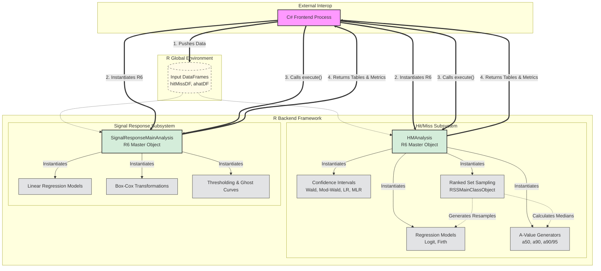

# POD Professional v4.5 - R Backend Documentation

## Overview
The R backend serves as the core statistical computational engine for the **Probability of Detection (POD) Professional v4.5** application. It performs rigorous statistical modeling, data transformations, confidence interval estimations, and metric calculations to evaluate Non-Destructive Evaluation (NDE) inspection reliability. 

The backend processes two primary types of POD data:
1. **Hit/Miss (Binary) Data:** Evaluates inspections where a flaw is discretely detected (1) or missed (0). 
2. **Signal Response ($\hat{a}$ vs. $a$) Data:** Evaluates inspections where the system returns a continuous signal magnitude ($\hat{a}$) relative to a known flaw size ($a$).

---

## Dependencies (Frozen R Libraries)
Because this codebase represents a frozen release of the analytical engine, specific R packages and versions are required to ensure mathematical consistency and reproducible outputs. 

### Standard / Base R Packages (Included with R 4.1.2)
* `methods`, `stats`, `splines`, `parallel`

### Production Requirements (CRAN Packages)
*(These must be installed in the production environment for the C# interop to function correctly).*
* `MASS` **(v7.3-54)**: Required for Box-Cox power transformations and regression algorithm support.
* `logistf` **(v1.22)**: Required for Firth's penalized-likelihood logistic regression (used for handling separated data).
* `nlme` **(v3.1-160)**: Required for Generalized Least Squares (GLS) modeling in Signal Response analyses.
* `car` **(v3.1-1)** & `carData` **(v3.0-5)**: Required for advanced linear model hypothesis testing (e.g., Durbin-Watson tests).
* `survival` **(v3.4-0)**: Required for handling right/left censored data in continuous models.
* `pracma` **(v2.4.2)**: Required for practical math functions (matrix operations mirroring MATLAB functionality).

### Custom / Patched Packages
* `minimcprofile`: A lightweight, GPL-compliant modification/replacement of the standard `mcprofile` library. Used specifically to generate Likelihood Ratio (LR) and Modified Likelihood Ratio (MLR) confidence intervals.

### Development & Testing Dependencies (Not Required for Production)
*(These packages appear in the standalone R scripts used by developers to test models locally or generate headless plots in RStudio. The production C# application handles all UI charting and Excel exports natively, so these are not needed in deployed environments).*
* `ggplot2`, `gridExtra`, `ggResidpanel`, `corrplot` *(For local UI/Plotting)*
* `xlsx` *(For local Excel export testing)*

---

## Code Organization
The R codebase is strictly object-oriented, utilizing R's **R6 class system** to encapsulate data, methods, and state. The file structure is divided into two primary analytical domains:

### 1. `HitMiss/`
Contains the logic for binary POD analysis.
* **`HitMissMainAnalysisRObject.R`**: The main orchestrator (`HMAnalysis`). It routes data to the appropriate models, calculates goodness-of-fit (e.g., AIC, McFadden's Pseudo R-Squared), and structures output tables.
* **Regression Models**: `HMLogitApproximationRObject.R` (standard logistic regression) and `HMFirthApproximationRObject.R` (Firth's penalized bias-reduction regression).
* **Confidence Intervals**: Modules for Standard Wald (`WaldCI_RObject.R`), Likelihood Ratio (`LRConfIntRObject.R`), and Modified Likelihood Ratio (`MLRConfIntRObject.R`).
* **Ranked Set Sampling (RSS)**: A complex sub-framework (`RankedSetSamplingMainRObject.R`, `RankedSetRegGen.R`) that resamples small datasets to produce more robust POD estimates by generating multiple logistic regression models and returning their median statistics.
* **Metrics**: `GenAValuesOnPODCurveRObject.R` calculates critical flaw sizes like $a_{50}$, $a_{90}$, and the $a_{90/95}$ confidence bound.

### 2. `SignalResponseCode/`
Contains the logic for continuous signal regression analysis.
* **`SignalResponseMainAnalysisRObject.R`**: The main orchestrator (`AHatAnalysis`) for $\hat{a}$ vs. $a$ data.
* **Transformations**: `BoxCoxTransform.R` manages Box-Cox power transformations for non-linear variance stabilization.
* **Metrics & Thresholding**: Modules that take a defined decision threshold and calculate the resulting continuous POD curve, variance-covariance matrices, and residual error distributions.

---

## API Structure & C# Frontend Integration
The R backend is designed to act as a stateless, strictly controlled server process. It does not contain or trigger UI code. Instead, it exposes a programmatic API intended to be consumed by the C# frontend via `RDotNet`.

The lifecycle of an analysis follows a strict **Push $\rightarrow$ Initialize $\rightarrow$ Execute $\rightarrow$ Retrieve** pattern:

1. **Data Push:** The C# frontend prepares the user's data and executes raw R scripts to construct `data.frame` objects directly in the R Global Environment (e.g., `hitMissDF`).
2. **Initialization:** The C# application instantiates the master R6 object, passing the global dataframes and configuration parameters (like model type, CI type, and sampling parameters) into the constructor:
   ```R
   newAnalysis <- HMAnalysis$new(
       hitMissDF = hitMissDF, 
       modelType = 'Logistic Regression',
       CIType = 'StandardWald',
       N = nrow(hitMissDF),
       normSampleAmount = 500
   )
   ```
3. **Execution:** C# invokes specific execution methods on the R6 object depending on the user's workflow:
   * `newAnalysis$executeFullAnalysis()`: Runs the complete regression, CI calculation, and metric generation.
   * `newAnalysis$executeFitAnalysisOnly()`: A lightweight run used purely for generating visual regression curves when the user is rapidly cycling through axis transforms.
   * `newAnalysis$initializeRSS()`: Diverts execution into the Ranked Set Sampling pipeline.
4. **Data Retrieval (Getters):** Once the execution completes, the C# frontend pulls the calculated matrices, tables, and metrics back out of R memory using exposed getter methods. The API is designed to return data in primitive types or clean dataframes that easily convert to C# `DataTable` objects.
   * **Tables:** `getResults()`, `getResidualTable()`, `getIterationTable()`
   * **Metrics:** `getKeyAValues()`, `getGoodnessOfFit()`, `getAIC()`
   * **Matrices:** `getCovMatrix()`
   * **Flags:** `getSeparation()`, `getConvergedFail()`

---

## R Backend Framework Architecture

