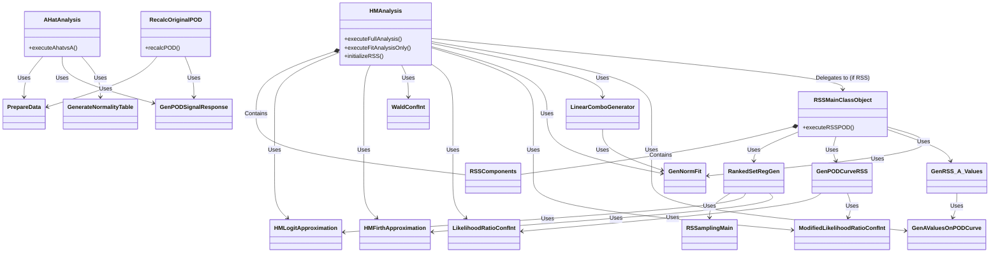

# Probability of Detection Professional version 4.5        

  POD Pro v4.5 (Probability of Detection Professional version 4.5) is the new and improved version of PODv4 which incorporates advanced statistics and an r backend. There have also been bug fixes related to the original PODv4.

### Branch Notes

### License

  Unlike PODv4, POD Pro v4.5 is open-source-software licensed under the GNU General Public License version 3 or later (**GPLv3+**). This means that anyone has the right to change, copy, modify, use, or study all of the code within POD Pro v4.5 under the terms of GPLv3. For full license text, see [https://www.gnu.org/licenses/gpl-3.0.en.html].

### Installation Instructions

  If you wish to download POD Pro v4.5 for your computer, please click on the tag with the latest release (current latest release is POD Pro v4.5.0 beta as of January 2023). From there, simply download the installer (.msi). Once download, open the installer, and the wizard will guide you through the process. A copy of R-4.1.2 with the necessary libraries is included in the installation, so the application is ready to run upon completing the installation wizard. A shortcut for POD Pro v4.5 will be added to the desktop. If you cannot find the .exe, simply type POD Pro v4.5 in the search bar and the application should appear. 
  
### Running the Development version in Visual Studio

  POD Pro v4.5 was written in visual studio 2019. In order to clone and run POD Pro v4.5 in visual studio. Clone this github repository and open the 'Winforms POD UI.sln' located in /'POD Source Code'/. Once the solution is open in visual studio, set the startup project to **FORMS** and run the solution. The configuration should be set to Any CPU. The solution can run in either 32 or 64 bit (prefer 32-bit is set by default). If you wish to run the application in 64 bit, open the **FORMS** project properties > build > uncheck prefer 32-bit. Do NOT run the program in x86 (some features will cause the program to crash due to bottlenecking the 32-bit RAM allocation).
  
### New Features in POD Pro v4.5.0

  POD Pro v4.5.0 is the first release of POD Pro v4.5. It offers a wide range of features not previously included in PODv4. In addition, the backend analysis for POD Pro v4.5 is written in the statistical programming langauge R in order to more easily accomadate the new statistical methods for POD through the use of CRAN libraries. The features specific to POD Pro v4.5.0 are listed below:

###### Hit/Miss Analysis

There have been many features and drastic improvements in hit/miss analysis for POD Pro v4.5.0:

* **Plotting Confidence Interval Curve**: In PODv4, the python algorithms often struggled to plot the confidence _a9095_ curve even when the logistic regression algorithm converges easily. POD Pro v4.5.0 can correctly generate and plot the wald _a9095_ curve for the user in the analyis wizard -> full regression analysis.

* **New Regression Technique**: Hit/Miss POD has traditionally been calculated using maximum likelihood logistic regression. However, in the cases, this algorithm may fail to converge when the data is separated (i.e. the 0s and 1s don't overlap), or when there are outliers present. To accomodate for this, POD Pro v4.5.0 offers _Firth's Bias-Reduced Logistic Regression_ . This new regression method is capable of producing an _a90_ curve for tricky datasets.

* **New Confidence Interval Techniques**: POD Pro v4.5.0 has three new statistical methods to general both the _a9095_ value and the _a9095_ curve. These methods include _Modified Wald_, _Likelihood Ratio confidence interval_, and _Modified Likelihood Ratio Confidence Interval_. More information can be found about these new confidence interval techniques in /'POD Documents'/

* **Alternative Sampling Method**: As an alternative to simple random sampling, POD Pro v4.5.0 offers Ranked Set sampling to assist in creating both the POD curve and the  _a9095_ curve. This feature is especially useful when the sample size is relatively small. 

A _Quick Help_ message box is present in the Hit Miss wizard in order to aid and explain to the user what each feature dropdown does. In addition, errors are more specfic when they occur (i.e. a9095 is infiniti), and will often give users suggestions in order to improve the quality of the results.

###### Signal Response Analysis

Signal Response has been rewritten to be calculated in R in addition to:

* **Box-Cox Transformation**: In addition to the transformations included in PODv4, POD Pro v4.5.0 can perform a box-cox transform on the signal responses. When clicked, a default lambda value will be generated by R. However, the user has freedom to alter lambda with a numeric up-down box in order to improve the test assumptions (equal variance, test for normality etc).

* **Normality histogram chart** : A normality chart featuring a histogram of the frequency of the responses has been added in order to aid the user in determining the normality of the signal responses. A normal curve with the mean and sigma of the response values is overlaid on the histogram to help the user see how 'normalish' are the responses.

Based on the provided R source files, the codebase for the Probability of Detection (POD) backend does not rely on deep traditional Object-Oriented inheritance (where one class inherits from a base class). Instead, it uses R's Reference Classes (`setRefClass`) to manage state and logic, and relies heavily on **composition and dependency**.

The architecture is divided into two primary analysis branches: **Hit/Miss Analysis** (for discrete/binary detection data) and **Signal Response Analysis** (for continuous $\hat{a}$ vs $a$ data).

Here is an explanation of the class hierarchy and structural relationships:

### 1. Hit/Miss Analysis Subsystem

The entry point for binary hit/miss data is the `HMAnalysis` class. It acts as a controller that coordinates various "worker" classes based on the user's settings.

* **Regression Models:** `HMAnalysis` delegates the statistical curve fitting to either `HMLogitApproximation` (standard logistic regression) or `HMFirthApproximation` (Firth's bias-adjusted logistic regression).
* **Confidence Intervals:** Once the curve is fit, `HMAnalysis` calculates confidence boundaries by calling `WaldConfInt`, `LikelihoodRatioConfInt`, or `ModifiedLikelihoodRatioConfInt` depending on the user's configuration.
* **Utilities:** It uses `GenAValuesOnPODCurve` to extract critical flaw sizes ($a_{90}$, $a_{90/95}$, etc.) and relies on `GenNormFit` and `LinearComboGenerator` to simulate crack sizes and generate combination matrices for the likelihood ratio tests.

### 2. Ranked Set Sampling (RSS) Subsystem

If the user enables Ranked Set Sampling instead of Simple Random Sampling, `HMAnalysis` hands control over to `RSSMainClassObject`.

* `RSSMainClassObject` holds an instance of `RSSComponents` (which stores the $m$ and $r$ parameters).
* It uses `RankedSetRegGen` to actually generate the samples (which in turn uses `RSSamplingMain` and fits regression models to the subsets).
* It uses `GenPODCurveRSS` to calculate the final POD values from the medians of the subsets and `GenRSS_A_Values` to calculate the critical flaw sizes for the RSS data.

### 3. Signal Response Subsystem

For continuous response data, the main controller is `AHatAnalysis`.

* It relies on `PrepareData` to average multiple responses if needed.
* It uses `GenPODSignalResponse` to convert the linear model and variance-covariance matrix into a standard POD curve space.
* It uses `GenerateNormalityTable` to generate histograms and frequency curves to check the normality of the residuals.
* There is also a `RecalcOriginalPOD` class used specifically to recalculate ghost curves using the $\tau$ values from previous analyses.

---

### Mermaid Class Diagram

Below is the Mermaid script detailing these composition and dependency relationships in the R Source Code:

